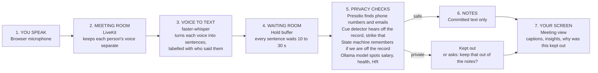

# OTR Agent: a consent-first meeting notetaker

A meeting notetaker with per-person consent and local transcription and filtering. It listens for how people signal privacy: "this is off the record", "strike that", "forget what I said about X", and the content nobody labels (a salary, a health detail, an HR matter). Every transcribed sentence waits in a **hold buffer** before it can reach the notes. A **cue detector** hears spoken signals, a **state machine** tracks each speaker's recording state, and a local language model handles the harder judgments. The public demo uses cloud services for the call and web access; see the data boundary below. Early research prototype; read "What is verified" before trusting any number.

Details: [docs/PRD.md](docs/PRD.md) (Part 1 is the frozen foundation), [docs/ARCHITECTURE.md](docs/ARCHITECTURE.md).

## The problem

- Meeting assistants leak. In ConfAIde Tier 4, GPT-4 and ChatGPT leak a secret into the **meeting summary** 39% and 57% of the time ("Leaks Secret", mean of 10 runs) even with a privacy instruction in the prompt; worst case 80%/85%. Action items: 29%/38%. (Table 4 of arXiv 2310.17884; [docs/RESEARCH.md](docs/RESEARCH.md) F1-F4, verified in source.)
- Prompting alone helps less than hoped on some benchmarks. In PrivacyLens, the helpfulness-adjusted leak rate under a privacy-enhancing prompt is 25.68% (GPT-4) and 38.69% (Llama-3-70B); the prompt moved GPT-4 only from 27.23 to 25.68 (arXiv 2409.00138, RESEARCH.md F9-F11). Caveat: newer models with chain-of-thought can cut leakage a lot but then omit more public content (1-2-3 Check, RESEARCH.md F14), so leak and omission must be reported together.
- We found no prior published evaluation of spoken off-the-record cues, scope end or retroactive requests in streaming meeting transcription (RESEARCH.md bottom line, item 5). That is not a claim of no prior work: a Zoom patent (US 11,974,074 B2) claims keyword-triggered off-the-record requests. Our own hypothesis (structure beats prompting) is only conditionally supported by the literature.

## Architecture

In the current public demo, LiveKit Cloud carries call audio and video. Vercel serves the page, and the API path passes through Vercel and a Cloudflare tunnel to the local meeting service; control requests and approved transcript responses traverse that path. Transcription, filtering, and note assembly run on the host laptop. This demo does **not** meet the project's fully local deployment goal. See [docs/PRD.md](docs/PRD.md) A-011 and [docs/PUBLIC_MEDIA_DEMO.md](docs/PUBLIC_MEDIA_DEMO.md).



1. **Speak.** A person talks into the browser microphone; each person controls their own recording consent.
2. **Meeting room (LiveKit).** LiveKit keeps each person's audio track separate. The public demo uses LiveKit Cloud; a self-hosted local server remains an option for local deployments.
3. **Voice to text (faster-whisper).** Local speech-to-text turns each track into speaker-labelled sentences.
4. **Hold buffer.** Each sentence waits (10 s by default in the demo) before it may reach the notes.
5. **Privacy checks.** Presidio (regex fallback if absent) masks emails, phone numbers and similar; the cue detector reads "off the record", "back on the record", "strike that"; the state machine keeps the scope; a local Ollama model (default `granite4.2:3b`, keyword fallback if Ollama is down) judges unlabelled sensitive content.
6. **Notes.** Only text that passed every check is committed; later removals are logged.
7. **Screen.** The meeting view shows approved captions, what was kept out and why.

Per-segment flow and demo-beat sequences: [docs/ARCHITECTURE.md](docs/ARCHITECTURE.md). Honest caveats per step are in the table at the top of its section 0.

## What is built vs. what is verified

Built: hold buffer, cue detector (with ASR-noise repair and false-alarm checks), state machine, PII pass, pipeline, runtime, replay and LiveKit ingest, FastAPI demo server, 3-level meeting UI, per-person consent page, benchmark harness (`bench/`). Source: [docs/STATUS.md](docs/STATUS.md), [docs/ARCHITECTURE.md](docs/ARCHITECTURE.md).

Verified, strictly:

- **Offline tests pass** (`python -m pytest tests -q`). STATUS.md pass 2 recorded 74 passed; the count moves as workers add tests, so rerun it. The Presidio path is not covered by that run (tests set `OTR_NO_PRESIDIO=1`).
- **Public call connection:** A host and guest joined the deployed page through LiveKit Cloud and saw each other. A separate end-to-end test used synthetic speech to exercise consent, local transcription, and note generation. The host and a friend also reported that their real browser call worked. We have not measured real-voice transcription accuracy.
- **Visual review:** The meeting UI has been opened in an ordinary browser. Earlier notes in [docs/STATUS.md](docs/STATUS.md) and [docs/LOCAL_PRIVACY.md](docs/LOCAL_PRIVACY.md) describe a prior checkpoint.
- **The LLM path has not been scored.** All benchmark numbers below are `llm: none` (rules and keyword fallback). STATUS.md: Ollama path never run against the benchmark.
- **Benchmark is small and synthetic**, written by the team that built the systems; labels mostly unreviewed ([bench/README.md](bench/README.md)). `-stub` baselines are heuristics, not LLMs.

Numbers (system C is ours; all `llm: none`; "Leak" = items with a private segment in the notes):

| Set | Source file | A (rules+PII) | B-stub | C |
|---|---|---|---|---|
| Dev, 47 items, **tuned on** (segment leak) | `bench/results.md`, STATUS.md pass 2 | 21% | 27% | 1% |
| Held-out, 36 items (item leak, 22 with private content) | `bench/results_heldout.md` | 17/22 = 77% | 17/22 = 77% | 5/22 = 23% [10%-43%] |
| Held-out noisy (ASR-style), 36 items | `bench/results_heldout_noisy.md` | 17/22 = 77% | 17/22 = 77% | 7/22 = 32% [16%-53%] |

The dev-set number is a regression check, not evidence: heuristics were written while reading those items. The **held-out result is the honest one**: C leaks 23% (noisy: 32%) versus 77% for A and the B-stub, but also omits public content in 25% (noisy: 28%) of items, and per-case-type cells hold 4-6 items so they are descriptive only. The held-out set was written by the same team; intervals are wide. No claim against a real LLM baseline is supported yet.

## Quickstart

Requirements: Python 3.12, `pip install -r requirements-core.txt -r requirements-demo.txt` (add `requirements-ingest.txt` for voice, `requirements-pii.txt` for Presidio, `requirements-bench.txt` for charts). Full machine setup (Windows, downloads, sizes): [docs/SETUP.md](docs/SETUP.md); `python scripts/check_env.py` reports what is missing.

```bash
python -m pytest tests -q                                   # offline tests

# Replay demo: no audio, no Docker
python -m demo.server --script demo/scripts/demo_main.txt   # then open http://127.0.0.1:8000/
python -m demo.server --script demo/scripts/demo_main.txt --pipeline real --llm ollama:granite4.2:3b

# Voice demo: needs Docker (or livekit-server), local Whisper weights, requirements-ingest.txt
docker compose -f docker-compose.livekit.yml up -d
HF_HUB_OFFLINE=1 python -m demo.server --source livekit --pipeline real --host 127.0.0.1 --port 8765
# open http://127.0.0.1:8765/ in two tabs; each person joins and starts "Not recorded"
```

Ollama (optional, only for the language-model checks): `ollama pull granite4.2:3b` (default in `otr/llm.py`; override with `OTR_LLM_MODEL`). Without it the pipeline falls back to keyword checks. Voice-demo details: [docs/INGEST.md](docs/INGEST.md) and [docs/RUNNING.md](docs/RUNNING.md). The commands above start a local LiveKit setup; the public demo uses the separate path in [docs/PUBLIC_MEDIA_DEMO.md](docs/PUBLIC_MEDIA_DEMO.md).

Benchmark: `python -m bench.run_eval --set all` regenerates dev, held-out and noisy results; see [bench/README.md](bench/README.md).

**The three pages.** The meeting UI has three levels (names per the plan: Realtime, Insights, Explainability; the current code and ARCHITECTURE.md section 4 call them meeting view, Insights and "Why?"):

1. Realtime: tiles, captions of committed lines only, status pill (recording / off the record), Live button.
2. Insights: counts, state timeline, final notes, and a list of what was kept out as kinds of redaction with reasons, not the specifics (text hidden by default).
3. **Explainability** ("Why?"): the rule that fired, state before and after, hold timeline; text only after clicking Reveal.

The shared operator view can send private event text to its browser even when the UI hides it. The per-person consent page sends approved text and text-free redaction details instead. Use the consent page for the public demo; see [docs/ARCHITECTURE.md](docs/ARCHITECTURE.md).

## Repo map

| Path | What it is |
|---|---|
| `otr/` | Engine: `pipeline.py`, `hold_buffer.py`, `cue_detector.py`, `state_machine.py`, `pii.py`, `llm.py`, `runtime.py`, `types.py` (the Segment/Event contract) |
| `otr/ingest/` | Replay source, LiveKit source, STT, diarization placeholder, token minting |
| `demo/` | FastAPI server, per-person consent session, `static/` pages, `scripts/` demo transcripts |
| `bench/` | OTR-Bench (dev, held-out, noisy sets), systems A/B/C, metrics, results `*.md/json/png` |
| `tests/` | Offline test suite |
| `scripts/` | `check_env.py`, `llm_check.py` |
| `docs/` | PRD, ARCHITECTURE, RESEARCH, STATUS, WORK_SPLIT, CHANGES, LESSONS_LEARNED, INGEST, SETUP, LOCAL_SETUP, LOCAL_PRIVACY, TTS_EXPERIMENT, `research/` drafts |
| `docker-compose.livekit.yml`, `requirements-*.txt` | Local LiveKit server; dependency sets |

## Contributing and docs conventions

- Work split ([docs/WORK_SPLIT.md](docs/WORK_SPLIT.md)): Lance owns the live meeting path (`otr/ingest/`, `demo/`, LiveKit); Deekshith owns local NLP and policy (pipeline modules in `otr/`, `bench/`). `otr/types.py` is the shared seam: change it only with both owners' agreement.
- Consent is per participant and defaults OFF; shared feeds carry only policy-approved text.
- [docs/CHANGES.md](docs/CHANGES.md) and [docs/LESSONS_LEARNED.md](docs/LESSONS_LEARNED.md) are **append-only**, newest first, with the entry formats given at their tops.
- [docs/PRD.md](docs/PRD.md) Part 1 is **frozen**; new decisions go in Part 2 (addenda 2.7, results log 2.5). [docs/STATUS.md](docs/STATUS.md) is regenerated each pass.
- RESEARCH.md numbers are corrected only with a matching update-log entry; keep its confidence tags when citing.
- Be honest in wording: the benchmark is early evidence, and real-voice transcription accuracy has not been measured.

## Limitations and roadmap

- Real-voice transcription and cue accuracy have not been measured; STT can mishear cue phrases, and the cue detector can mistake a movie title or quote for a signal.
- The sensitive-content check is incomplete for contextual HR and numeric disclosures ([docs/LOCAL_SETUP.md](docs/LOCAL_SETUP.md)); a 3B local model will miss subtle cases, and the literature suggests the local LLM bounds the implicit class (RESEARCH.md bottom line, item 4).
- Off is not "zero leak by construction": other people can paraphrase, mics bleed, and other participants can still hear someone whose notetaker consent is OFF (RESEARCH.md item 7, LOCAL_PRIVACY.md).
- The same-machine LiveKit `--dev` server uses placeholder credentials; do not expose it to a LAN or the internet.
- Open issues I4 and I5 (and unreviewed labels, I6) are tracked in [docs/WORK_SPLIT.md](docs/WORK_SPLIT.md).
- Roadmap: Google Meet / Zoom through a bot API such as Vexa or Attendee (not implemented, INGEST.md); speaker opt-out refinements; a retraction-delay study (how long hold must be for retroactive "strike that" to catch text; first sweep in `bench/results_sweep.md`); a larger frozen held-out set, a real LLM baseline (B+) and hand-checked labels (STATUS.md next actions).

## License

MIT, see [LICENSE](LICENSE).
