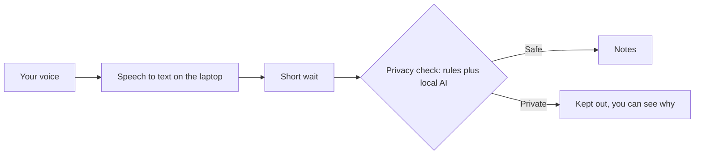
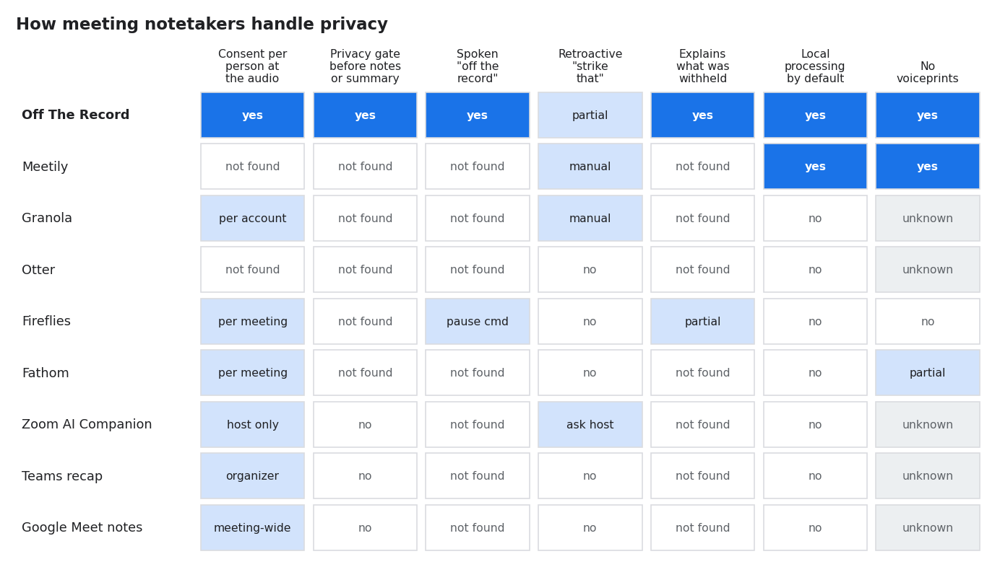
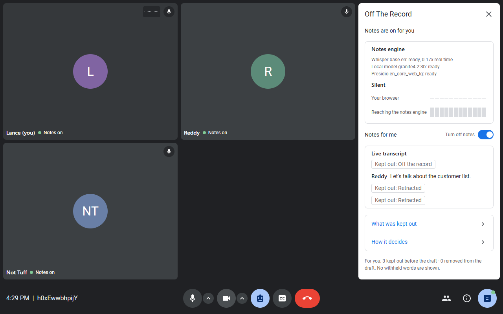
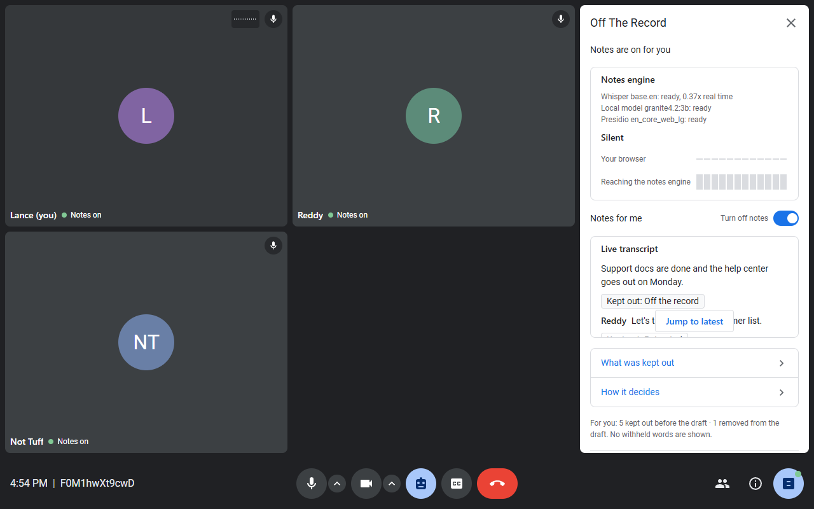

# Off The Record

A meeting notetaker that runs on your own computer and lets each person control what goes into the notes.
It listens for "off the record" and "strike that", and it keeps out private content such as pay or health
details even when nobody says anything.

New to this? Read [docs/HOW_IT_WORKS.md](docs/HOW_IT_WORKS.md) first. It needs no technical background.

## How it works



- **Consent per person.** Each person turns their own notes on or off. If off, their voice is never transcribed.
- **Local processing.** Speech to text (faster-whisper) and the privacy model (Ollama) run on the host's computer.
- **Hold buffer.** Each sentence waits a few seconds before it can enter the notes, so "strike that" can still catch it.
- **Checks.** Presidio hides contact details. A cue detector and a small state machine track "off the record". A local model judges sensitive topics. If the model is missing, keyword rules are used.
- **Views.** Realtime captions, Insights (kinds kept out, never the text) and How it decides (a short explanation).

More detail: [docs/ARCHITECTURE.md](docs/ARCHITECTURE.md).

## How we compare

Based on [docs/COMPETITORS.md](docs/COMPETITORS.md). Where we differ from the tools we looked at:

| Point | Off The Record | Others |
|---|---|---|
| Consent | Per person, at the audio | Per account, per meeting or host only |
| Privacy gate | Before the notes or summary | Summarise everything, then restrict access |
| Spoken "off the record" | Handled by content | Manual pause at most |
| "Strike that" | Retroactive, removes the line just said | Manual or none |
| Explaining a removal | Says what kind of thing was withheld, without showing it | Not found in their docs (Fireflies partial) |
| Processing | Local by default | Cloud products process in the cloud; Meetily is also local |
| Voiceprints | None | Fireflies uses voice data; most others do not say |



Numbers: on the realistic sealed set, our pipeline let private lines into the notes less often than rule based baselines (leak 67% versus 87%, see [docs/RESULTS.md](docs/RESULTS.md)). For context, ConfAIde reports that general LLMs leak 39 to 57% of secrets in meeting summaries even when told not to. Those are other papers' numbers and are not directly comparable.

## The three ways a line is removed (live run)

### You say it
"This next part is off the record" keeps everything out until "back on the record", including other people's reactions.


### You take it back
"Strike that" removes the line you just said.



### Nobody says anything
Salary, a performance plan, layoffs and a health matter are caught by the local model and kept out while notes keep running. You can also remove your own line with one click.




Afterwards, [what was kept out](docs/images/showcase/09-insights-reddy.png) and [why](docs/images/showcase/11-why-kept-out-not-tuff.png).

The run had three participants (Reddy, Lance, Not Tuff) through the real call, speech to text and local model on the host laptop. Proof files: `docs/showcase/proof_*.json`.

## Run it

Requirements: Python 3.12, Docker (for the call server), and optionally Ollama.

```
pip install -r requirements-core.txt -r requirements-demo.txt -r requirements-ingest.txt -r requirements-pii.txt
ollama pull granite4.2:3b
python scripts/check_env.py
python -m otr.app --source livekit --port 8010 --fast
```

Open http://127.0.0.1:8010/ for the meeting and http://127.0.0.1:8010/meet for the Realtime, Insights and How it decides view.
Turn your notes on before you speak. The first line appears after the hold time (2 seconds with `--fast`, 5 by default).

No microphone? Replay a script instead:

```
python -m otr.app --source replay --script demo/scripts/demo_main.txt --speed 4 --hold 3
```

Check redaction yourself:

```
python scripts/redaction_check.py --llm ollama
python scripts/redaction_check.py --live
python -m pytest tests -q
```

The demo script and talking points are in [docs/DEMO_SCRIPT.md](docs/DEMO_SCRIPT.md).
Every launcher option: [docs/RUNNING.md](docs/RUNNING.md). Setting up a Windows machine from scratch: [docs/SETUP.md](docs/SETUP.md).

### Share it over the internet (optional)

```
python -m otr.service
```

This starts the meeting server, an ngrok tunnel and the on demand model service. It reads `.otr-service.json`:

```
{"tunnel": "ngrok", "ngrok_domain": "your-name.ngrok-free.dev", "port": 8765, "serve_page": true, "llm": "auto"}
```

The Ollama model stays unloaded until a meeting is created, then unloads after about 10 minutes idle.
Only the host's computer can list and switch models. Setup details: [docs/REMOTE.md](docs/REMOTE.md).
A tunnel provider can see the traffic that passes through it, so do not call this "end to end private".

## Honest status

- **Built:** consent per person, local speech to text, hold buffer, cue detector, PII masking, model assisted checks, three views, a one command launcher, a redaction check script, a benchmark.
- **Tested:** the offline test suite passes (`python -m pytest tests -q`). A browser with fake devices drove the call page. A live microphone with real people has not been tested by us.
- **Benchmark:** on realistic data (QMSum meetings with inserted private lines, written by language models and not reviewed by people), the pipeline without a model leaked in about 59 to 67 percent of private items. Simple rule baselines leaked in 85 to 87 percent. Over-removal of public text was 25 to 35 percent. This is far from zero. Numbers and caveats: [bench/data_v2/README.md](bench/data_v2/README.md).
- **Charts:** leak, over-removal, the hold sweep and a competitor grid, each with its caveat, are in [docs/RESULTS.md](docs/RESULTS.md).
- **Earlier small sets** reported lower leak rates because they were written knowing the cue lists. Treat them as regression checks, not evidence.
- **The model:** in one test it fixed pay and health cases but did not clearly help overall. It can only keep a scope open, never close one, because a small model ended scopes too early.

## Repository map

| Path | What it holds |
|---|---|
| `otr/` | The engine: pipeline, hold buffer, cue detector, state machine, PII, model client, launcher, service |
| `otr/ingest/` | Call audio, speech to text, replay and audio file sources |
| `demo/` | Web server and pages (`/` meeting, `/meet` three views, `/insights` pop out) |
| `bench/` | Benchmark data, systems, metrics, results |
| `scripts/` | Environment check, redaction check, helpers |
| `docs/` | Plain explanation, architecture, results, research, demo script, setup, project log |

## Contributing

- Lance owns the live meeting path (`otr/ingest/`, `demo/`). Deekshith owns the privacy engine and benchmark (`otr/`, `bench/`). `otr/types.py` is shared: change it only together.
- `docs/CHANGES.md` and `docs/LESSONS_LEARNED.md` are append only. Part 1 of `docs/PRD.md` is frozen.
- Keep claims honest: say what was measured, on what, and what was not.

## License

MIT. See [LICENSE](LICENSE).
