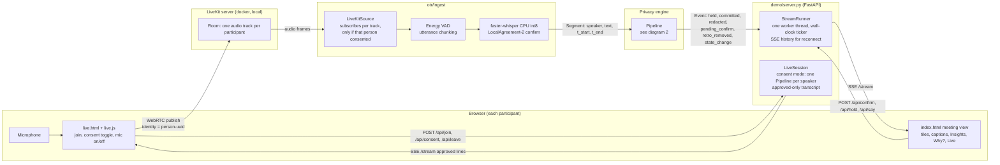
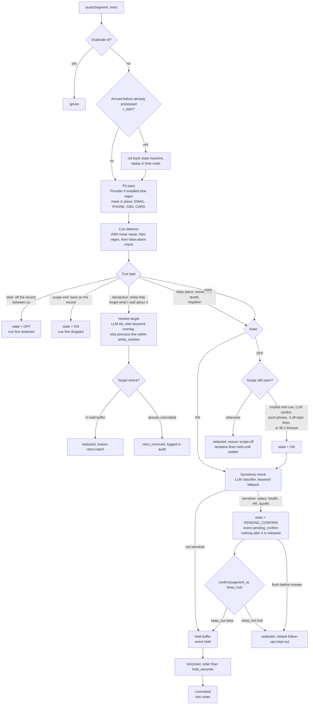
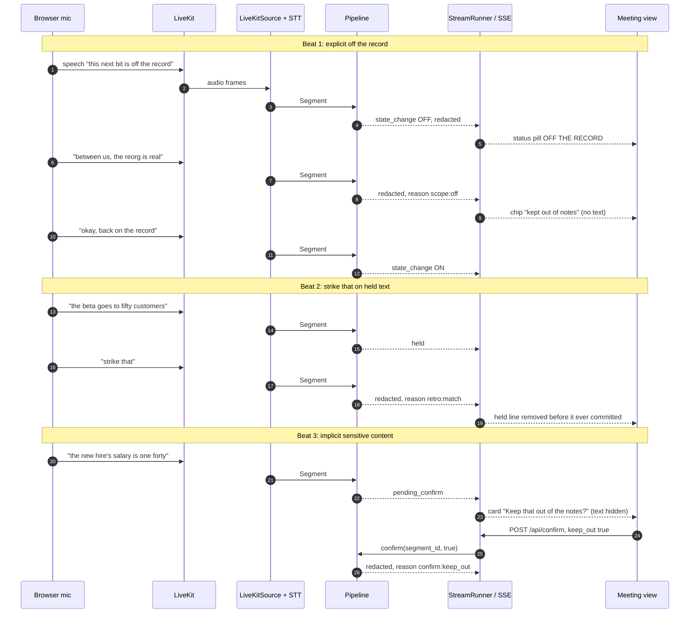
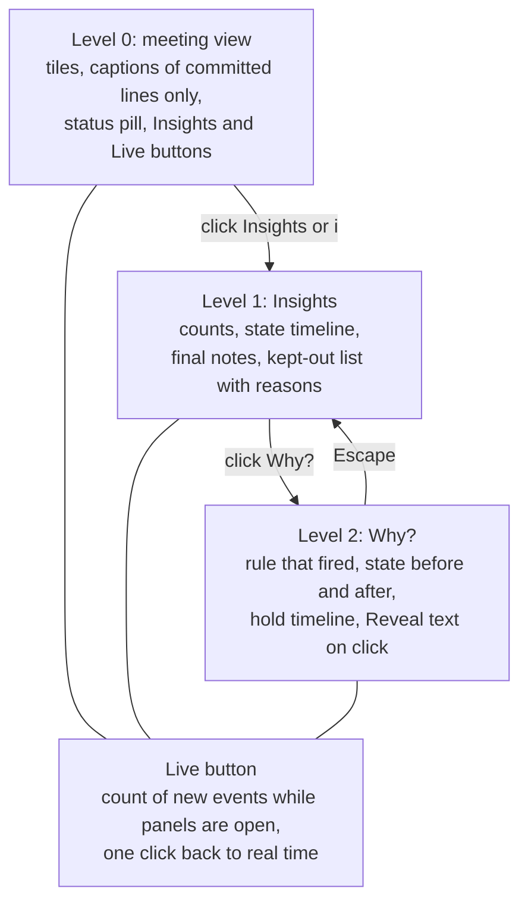

# Architecture: how voice becomes notes

Mermaid diagrams of the running system, drawn from the code on `master` (`otr/`, `demo/`). They render on GitHub and in VS Code with a Mermaid preview extension.

**Status legend** (applies to every diagram): nothing below the browser has been run against real voices yet. The LiveKit path, real speech-to-text and the Ollama language-model calls are untested end to end; the pipeline, runtime and demo server are covered by offline tests (`python -m pytest tests -q`).

## 1. End to end: voice in the browser to text on screen

Two demo modes share the same engine. They differ in who captures the voice and who sees the output.

Which pieces serve which mode:

| Mode (`python -m demo.server ...`) | Voices come from | Page served | Engine wiring |
|---|---|---|---|
| `--source livekit` (per-person consent, Lance) | Browsers join through `live.html`; mic published to LiveKit | `live.html` | `LiveSession`: one Pipeline per speaker; a sensitive hold pauses only that speaker |
| `--source livekit-stream` (shared view) | Any LiveKit client in the room (e.g. the LiveKit Meet app) | `index.html` | `StreamRunner`: one Pipeline over all speakers |
| `--source replay --script FILE` | Script file, no audio | `index.html` | `StreamRunner` |

**Gap to close:** `index.html` (the new meeting view) has no microphone capture of its own. Live voice enters only through `live.html` or another LiveKit client. Unifying them (mic and consent inside the meeting view) is the main frontend task left.

## 2. Inside the Pipeline: what happens to one Segment

Key properties, each backed by a unit test in `tests/test_pipeline.py`:

- `hold_seconds` is read at release time, so the UI slider affects text already held.
- Only committed segments reach `notes()`; the summary step must never see held or redacted text.
- `Pipeline` is guarded by a lock, because the runtime calls `push`, `tick` and `confirm` from different threads.
- With `llm=None` everything above still runs on rules and keyword checks.

## 3. Sequences for the three demo beats

## 4. Where the frontend sits

Private text is never drawn on level 0 or 1. It still travels to the browser in the event stream, so it is visible in developer tools; it appears on screen only after clicking Reveal text or Show text.

## 5. Component map

| Layer | Files | Role |
|---|---|---|
| Contract | `otr/types.py` | `Segment`, `Event`, `Pipeline` interface; the seam between the two work streams |
| Ingest | `otr/ingest/livekit_source.py`, `stt.py`, `replay_source.py`, `diarize.py`, `mint_token.py` | LiveKit track subscription, per-person consent, speech-to-text, script replay, mixed-audio fallback |
| Engine | `otr/pipeline.py`, `hold_buffer.py`, `cue_detector.py`, `state_machine.py`, `pii.py`, `llm.py` | The privacy pipeline in diagram 2 |
| Runtime | `otr/runtime.py` | Runs pipeline calls on one worker thread, ticks on wall-clock time, fans out events |
| Server | `demo/server.py`, `demo/live_session.py` | HTTP and SSE endpoints; consent-mode session |
| Frontend | `demo/static/index.html`, `live.html`, `live.js` | Meeting view; consent and mic page |
| Evaluation | `bench/` | OTR-Bench items, systems A, B and C, metrics, hold sweep |
