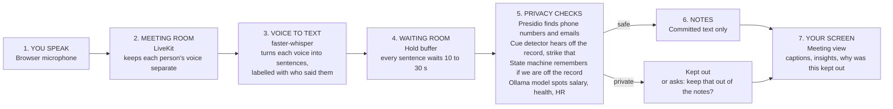
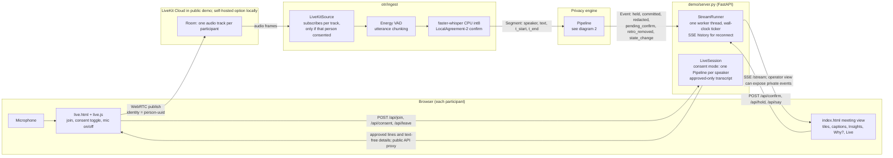
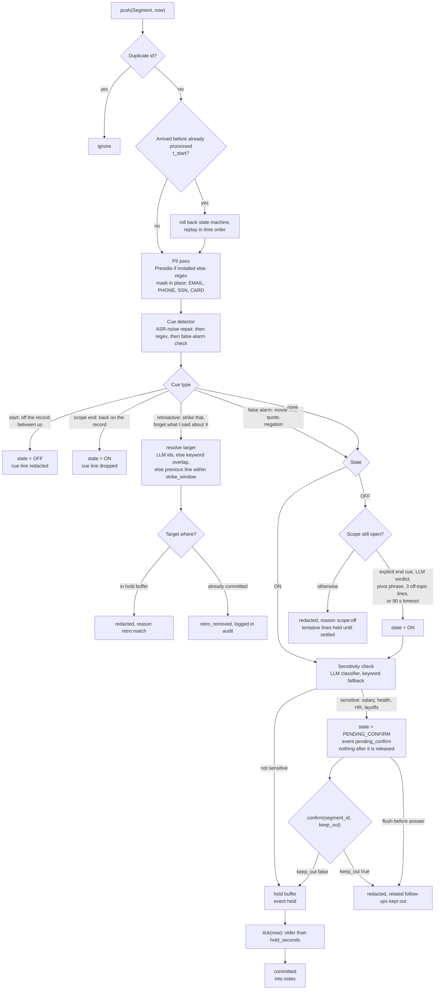
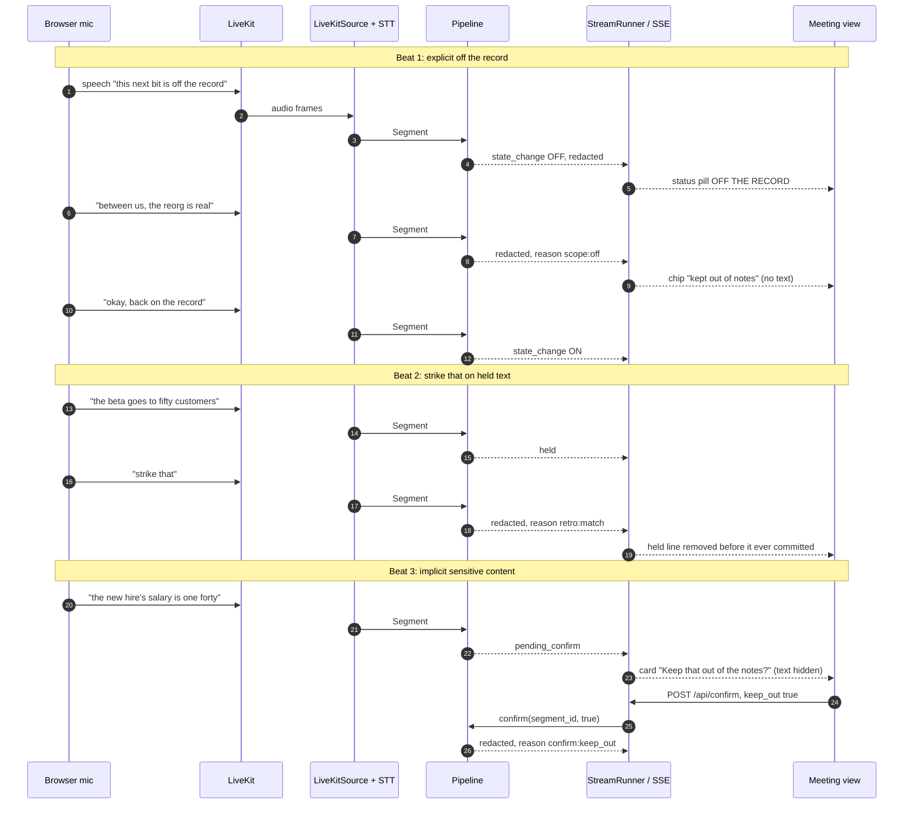
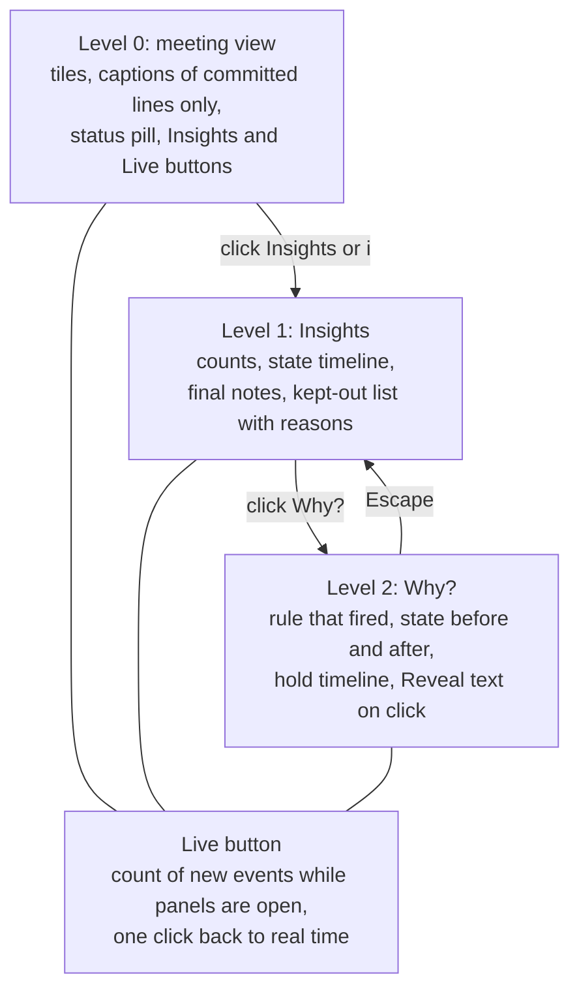

# Architecture: how voice becomes notes

Mermaid diagrams of the meeting and privacy pipeline (`otr/`, `demo/`). They render on GitHub and in VS Code with a Mermaid preview extension.

**Status legend:** The public call path has been tested with two real browsers, and a separate end-to-end test used synthetic speech through LiveKit, local transcription, and consent-gated notes. Real-voice transcription accuracy and the Ollama path have not been measured end to end. The diagrams show both the per-person consent page and a separate operator view; the latter has a different privacy boundary.

## 0. The simple version (start here)

People talk in a LiveKit room. The notetaker subscribes only to speakers who opt in; their text waits for a privacy check before it can reach the shared notes. In the current public demo, LiveKit Cloud carries call audio and video. Vercel and Cloudflare carry API requests and approved transcript responses to and from the host laptop, where transcription, filtering, and note assembly run. The long-term target is to host the whole path locally.

What each part does, in plain words:

| Step | Tool | What it does | What can go wrong |
|---|---|---|---|
| 1. Speak | Browser microphone | Sends your voice into the call; you separately choose whether the notetaker can use it | The call carries speech even when notes are off |
| 2. Meeting room | **LiveKit** | Keeps each person's audio track separate; the public demo uses LiveKit Cloud | Call media passes through a cloud service in the public demo |
| 3. Voice to text | **faster-whisper** | Speech-to-text. A sentence is only passed on once two passes agree on the words | Mishears words, including cue phrases like "off the record" |
| 4. Waiting room | **Hold buffer** | The key idea. Text waits before it can reach the notes, so a "strike that" said a few seconds later can still catch it | Adds delay to the live notes |
| 5a. Contact details | **Presidio** | Microsoft's open-source tool that spots emails, phone numbers and similar details and masks them. We use a simple pattern-matching version if Presidio isn't installed | Only finds obvious details, not secrets |
| 5b. Spoken signals | **Cue detector** | Listens for "off the record", "between us", "back on the record", "strike that", "forget what I said about X". Tolerates speech-to-text errors | Can mistake a movie title or a quote for a signal |
| 5c. Memory | **State machine** | Remembers if we are RECORDING, OFF THE RECORD, or waiting for your OK. Stays off until someone says we are back | Ending the off-the-record section too early leaks text |
| 5d. Unspoken secrets | **Ollama** (local language model) | Judges whether a sentence is sensitive without any signal, such as salary, health or HR. Falls back to keywords if Ollama isn't running | A small model misses subtle cases |
| 6. Notes | Committed list | Only text that passed every check. Anything removed later by "strike that" is deleted and logged | |
| 7. Your screen | Meeting view | The consent page shows approved captions and text-free redaction details | The separate operator view sends private event text to its browser; do not use it as the public consent page |

**What you see as a user:** a normal-looking meeting. Captions appear a few seconds late. If someone says "off the record", the status changes and their words vanish from the captions. If someone mentions a salary, a small card asks "Keep that out of the notes?" Click Insights to see what was kept out and why, and Why? on any item to see the exact rule that fired.

**Why it is built this way:** asking a language model once to "remove anything private" has been shown to leak (see [RESEARCH.md](RESEARCH.md)). So the simple, predictable parts (the waiting room, the cue rules, the state memory) do the heavy lifting, and the language model is used only for the hard judgment calls. Whether that beats a well-prompted model is exactly what the benchmark in `bench/` is meant to test, and the evidence so far is early and synthetic.

The rest of this file has the detailed diagrams.

## 1. End to end: voice in the browser to text on screen

Two demo modes share the same engine. They differ in who captures the voice and who sees the output.

Which pieces serve which mode:

| Mode (`python -m demo.server ...`) | Voices come from | Page served at `/` | Engine wiring |
|---|---|---|---|
| `--source livekit` (per-person consent) | Browsers join through the lobby page; mic and camera published to LiveKit | `live.html`: lobby, host admission, video, mic, Notes toggle, and the three views | `LiveSession`: one Pipeline per speaker; a sensitive hold pauses only that speaker |
| `--source livekit-stream` (shared view) | Any LiveKit client in the room (e.g. the LiveKit Meet app) | `index.html` (operator console) | `StreamRunner`: one Pipeline over all speakers |
| `--source replay --script FILE` | Script file, no audio | `index.html` (operator console) | `StreamRunner` |

Both pages show the same three views of the same pipeline, implemented once in `static/views.js` with one category table (`demo/categories.py`, served as `/static/categories.js`):

- Realtime: tiles with speaking rings, captions of approved lines, "kept out" placeholder chips, Live button, status pill, presenter mode.
- Insights: aggregate only. Kinds of things kept out (Off the record, Retracted, Personal and health, Pay and HR, Legal and confidential business, Contact details masked, Other sensitive) with counts, and a recording-state timeline. Never lists items, speakers or quotes.
- Explainability: the rule for each kind; opening a chip shows the generic trail (rule family, state before and after, hold timing). "Reveal text" exists only in the operator console, never in consent mode.

In consent mode the server sends approved transcript text and text-free details about withheld content. The public demo routes those responses through Vercel and Cloudflare to the participant's browser. Withheld text is not in those responses.

## 2. Inside the Pipeline: what happens to one Segment

Key properties, each backed by a unit test in `tests/test_pipeline.py`:

- `hold_seconds` is read at release time, so the UI slider affects text already held.
- Only committed segments reach `notes()`; the summary step must never see held or redacted text.
- `Pipeline` is guarded by a lock, because the runtime calls `push`, `tick` and `confirm` from different threads.
- With `llm=None` everything above still runs on rules and keyword checks.

## 3. Sequences for the three demo beats

## 4. Where the frontend sits

This level 0/1/2 diagram describes the separate operator view. It hides private text on its first two screens but still sends that text to the browser, where developer tools can see it. The public per-person consent page omits withheld text from its responses and does not offer Reveal text.

## 5. Component map

| Layer | Files | Role |
|---|---|---|
| Contract | `otr/types.py` | `Segment`, `Event`, `Pipeline` interface; the seam between the two work streams |
| Ingest | `otr/ingest/livekit_source.py`, `stt.py`, `replay_source.py`, `diarize.py`, `mint_token.py` | LiveKit track subscription, per-person consent, speech-to-text, script replay, mixed-audio fallback |
| Engine | `otr/pipeline.py`, `hold_buffer.py`, `cue_detector.py`, `state_machine.py`, `pii.py`, `llm.py` | The privacy pipeline in diagram 2 |
| Runtime | `otr/runtime.py` | Runs pipeline calls on one worker thread, ticks on wall-clock time, fans out events |
| Server | `demo/server.py`, `demo/live_session.py` | HTTP and SSE endpoints; consent-mode session |
| Frontend | `demo/static/index.html`, `live.html`, `live.js` | Meeting view; consent and mic page |
| Evaluation | `bench/` | OTR-Bench items, systems A, B and C, metrics, hold sweep |
