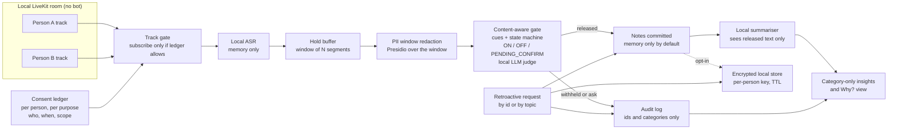

# Competitors: how "private" meeting notetakers actually work

Research pass of 2026-10-22. Scope: 16 products and projects, read from their own docs, repos, policies and trust pages where the network allowed. This is a design input for OTR, not a marketing comparison.

## 0. How to read the evidence tags

- **[V]** verified in source: I opened the vendor's own page (docs, repo, policy, trust page, release note) in this pass and saw the statement. A [V] on a policy or a documented setting means "the vendor states this". It does not mean the behavior was tested. Nobody outside the vendor can test most of it.
- **[S]** self-reported: marketing or a security claim on a vendor page that nobody has audited (for example "never stored", "SOC 2", "no data leaves").
- **[U]** unverified: seen only in a search snippet, a third-party blog, a university IT page or a law-firm note, or the page I opened did not say. "Not stated on page" is [V] about the page, not about the product.
- Page text was read through a fetch tool that summarises pages, so exact quotes are short and should be rechecked before they go on a slide.
- Court items are allegations in complaints. None is a finding.

## 1. Comparison tables

Abbreviations: ASR = speech to text. LLM = summariser. "Own" = vendor's own cloud.

### 1.1 Capture, ASR, summarisation

| Product | Capture path | ASR runs | Summaries run |
|---|---|---|---|
| Meetily (Zackriya, MIT) | Local desktop app, mic plus system audio, no bot [V] | On device, Whisper or Parakeet [V] | Ollama (local, recommended) or Claude, Groq, OpenRouter, custom endpoint, user chooses [V] |
| Hyprnote, now "anarlog" (MIT; `enterprise/` commercial) | Local app, device audio, "no bot joins your call" [V] | On device on supported Macs; managed Pro uses Soniox cloud; local or BYO options [V] | Local model, own API key, Ollama or LM Studio; managed default goes via OpenRouter to a Claude Sonnet alias [V] |
| Granola | Local app started by user, mic plus computer audio, no bot [V] | Third-party providers, Deepgram and Assembly named [V] | OpenAI and Anthropic named [V] |
| Krisp AI Note Taker | Audio-level capture through "Krisp Speaker" and "Krisp Microphone" devices, no visible bot; optional bot on Zoom [V page, S claims] | English on device, 15 other languages on servers (page claim) [S]; release note: on-device storage supports English transcription only [V] | Third-party providers, listed on its Trust Center (not opened) [V policy] |
| Otter | OtterPilot bot joins as an attendee when a calendar link exists [U, university IT pages]; also manual recording | Not stated on page I opened; AWS and "AI providers" as subprocessors [V policy] | Third-party AI providers via API, "do not store customer data" [V, vendor statement] |
| Fireflies | Bot ("Fred") joins; desktop app "Take Notes" also exists [V] | Providers not named, subprocessor list on trust site (not opened) [V] | Same, unnamed providers [V] |
| Fathom | Bot mode and bot-free mode (desktop) [V consent page] | Not stated on pages I opened [U] | Third-party providers named only as OpenAI, Anthropic, Google ("we do not authorize" them to train) [V] |
| Zoom AI Companion | Platform native | Zoom (own) [U for details]; temporary STT data discarded after summary [V] | Zoom models plus third-party providers; Zoom says relevant data is shared with them for the feature [V]; OpenAI and Anthropic named by university pages [U] |
| Teams intelligent recap (Teams Premium) | Platform native; needs transcription and recording on [V] | Teams transcription | Azure OpenAI inside the M365 compliance boundary; "not shared with non-Microsoft parties, including OpenAI" [V] |
| Google Meet "Take notes for me" | Platform native, Gemini | Google | Google; page I opened does not say [V absence] |
| Jamie | Local app, mic plus system audio, no bot [S] | "Streamed for transcription", location not stated; processing in EEA, Switzerland, UK [S] | Providers unnamed, "contractually enforced" no-training [S] |
| tl;dv | Bot [U, not on page I opened] | Not stated [U] | Anthropic named; meetings cut into small chunks with shuffled order, metadata anonymised [V page, S effect]; AI hosting Europe or US [V] |
| Vexa (Apache-2.0) | Bot joins Meet, Teams, Zoom as participant; self-host or cloud [V] | faster-whisper, self-hosted GPU service or hosted token [V] | Your own LLM endpoint possible [V] |
| Attendee (Elastic License 2.0) | Bot API, `bot_name` parameter [V] | Zoom needs a Deepgram key (page) [V]; others not stated | Not part of the project as described [V absence] |
| WhisperLiveKit (Apache-2.0) | A component, not a notetaker: streaming local ASR server (WebSocket) [V] | Local, several backends; some models downloaded at setup [V] | None |
| HushNote (MIT, Linux) | CLI records system audio and mic via PulseAudio or PipeWire [V] | faster-whisper, offline after setup [V] | Ollama (example `llama3.1:8b`) [V] |

### 1.2 Storage, retention, training

| Product | What is stored | Retention and deletion | Training policy |
|---|---|---|---|
| Meetily | Models, recordings and transcripts on your disk [V]; "no data ever leaves your computer" [S], false if a cloud summariser is chosen | No auto-delete seen; you delete files [V absence] | No vendor cloud in local mode, so none; not stated |
| Hyprnote/anarlog | Local SQLite for sessions, notes, transcripts; plain files for recordings [V]; cloud sync, hosted AI and sharing off by default [V] | Not stated on repo page | Not stated on repo page |
| Granola | No audio kept on desktop; mobile caches audio temporarily; transcript and notes on US AWS, encrypted [V] | Transcript auto-delete 1 day, 1 week, 1 month, 3, 6 months, 1 year or off; individuals have a 1 week cooldown, enterprise none; notes stay; deletion permanent; regeneration lost [V]. Manual transcript segment redaction [S, vendor blog] | Default: may use anonymised data, opt out in Settings; enterprise off by default; third parties barred from training [V] |
| Krisp | Cloud by default: "may store such meeting transcripts, recordings and summaries on our servers"; Business plan can store locally, English only, since 3.3.4 (June 2025) [V] | Kept until user instructs deletion; deletion by contacting privacy address; auto-recorded non-English audio deleted after transcript; support audio up to 6 months [V] | Policy unclear: says it does not "use such content for any purpose" yet lists "improving our proprietary AI models" under consent [V] |
| Otter | Audio and transcripts on AWS S3, AES-256 [V] | Deleted items sit in Trash 30 days [V]; otherwise "as long as necessary" [V] | Trains on de-identified audio and transcripts; says no human review without customer consent [V]; no training-specific opt-out found in policy [V absence] |
| Fireflies | Meeting content, voice data, participant names and emails [V] | "Zero Data Retention" claimed for vendors; closed accounts deleted within 30 days; Enterprise custom retention and private storage [V/S] | "We do not use personal information for AI model training"; the security page wording differs slightly ("by default") [V] |
| Fathom | Recordings, transcripts, voiceprints for opted-in iOS users [V] | Deletion "within 30 days" on best effort, no guarantee; team and enterprise data follows the admin, so user requests are redirected [V] | Default may use de-identified data for in-house models, opt-out in account settings; third parties not authorised [V] |
| Zoom | Summaries and transcripts per meeting retention policy; My Notes audio deleted after transcription [V] | Admin can set transcript retention to 0 days; summary then cannot be regenerated [V]; "365 days to trash" [U] | Zoom does not use customer audio, video, chat or similar content to train its or third-party models [V] |
| Teams recap | Transcript in organizer's Exchange and OneDrive; AI notes and tasks in participants' mailboxes [V] | Follows meeting recording retention (Purview) [V] | "Not logged or used for any AI model training or testing" [V] |
| Meet | Notes doc in organizer's Drive, attached to the event [V] | Follows the Meet retention policy your org set (one search snippet said Drive policy instead) [V/U] | Not stated on that page [V absence] |
| Jamie | Audio "never stored"; transcript and notes stored in EEA [S] | Admins set retention rules [S] | "Never used to train" by Jamie or providers [S] |
| tl;dv | AES-256 at rest, EU data centers [V page] | Not stated on pages opened [V absence] | "No customer data is used to train the AI" [V page, S effect] |
| Vexa | Recordings in your S3; knowledge as Markdown in git; at-rest encryption "planned" [V] | You decide [V absence] | Self-host: n/a |
| Attendee | Postgres and Redis; transcripts via API [V] | Not stated | n/a |
| HushNote | Trimmed MP3, transcript, summary, JSON in `~/meeting-notes/`; MP3 kept by default [V] | Manual | n/a; post-summary hook can send output to Notion or a webhook [V] |

### 1.3 Consent, speaker ID, pause, redaction, deletion, audit

| Product | Consent of other participants | Speaker identification | Pause / off the record | Redaction / PII | Retroactive deletion | Auditability |
|---|---|---|---|---|---|---|
| Meetily | None described [V absence] | Not in Community edition; planned in PRO [V] | None described [V absence] | None described | Delete files yourself | Open source (MIT), you can read the code |
| Hyprnote/anarlog | None described on repo page | Not stated | None described | None described | Local files | Open source |
| Granola | Optional automatic consent message plus video mark; per account owner; macOS, Zoom and Meet per docs (pages disagree on Meet) [V]; the user is told to get consent themselves [V] | Not stated on pages opened | Not found | Manual segment redaction [S]; no automatic PII detection [S] | Delete transcript or note; permanent [V] | Audit API "still developing" [S] |
| Krisp | Not described on pages opened; a third-party review calls it basic [U] | "Speaker-aware" with no method given [S] | Not found | Not found | Contact Krisp [V] | SOC 2 Type II claimed [S] |
| Otter | Obligation placed on users: "must always ask for consent" [V]; allegation: non-host attendees not asked by default [U] | Policy lists "Speaker Identification / Biometric Information" [V]; the word "voiceprint" does not appear [V] | Manual recording pause [U]; bot is visible [U] | Not found | Trash 30 days [V] | SOC 2 Type II claimed [S] |
| Fireflies | Strongest bot UX seen: email 1 hour before with decline link; pinned chat message; on Zoom and Meet SDK the bot joins only if approved, and one "Decline" blocks it [V] | Providers extract "voice characteristics" ("Voice Data") to separate speakers; policy says may count as biometric in some jurisdictions and gives an Illinois destruction schedule [V] | `/ff pause` in chat, or say "Hey Fireflies, please pause"; resume by chat only; paused span has no transcript and shows a marker; earlier content stays [V]. Pause may be Meet-only per FAQ [V] | Not found | "Contact the host or support" [V]; no self-service tool | SOC 2, HIPAA claimed [S] |
| Fathom | Consent emails 24 hours before external meetings; decline disables auto-record; no reply means it still joins; user responsible [V] | Voiceprint only for opted-in iOS users [V] | Not found in what I opened | Not found | 30 day best effort [V] | SOC 2 Type II [U] |
| Zoom | AI sparkle indicator for attendees; attendees can ask the host to turn it off and delete generated assets [V]; host starts it [U] | Platform identity (known participants) | Host turns feature off; no content-aware pause | Not found | Host deletes assets on request [V] | Admin controls [V] |
| Teams recap | Org-level; admins can customise a consent or notice message [U]; organizer controls who can record or transcribe via sensitivity label [V] | Platform identity; attendees can opt out of speaker attribution on live transcription [U] | Label-based "who can record and transcribe", meeting-wide | "Detect sensitive content during screen sharing" (screen only, not speech) [V]; copy and forward restrictions for transcripts and AI insights [V] | Purview retention and delete [V] | Purview, eDiscovery [V] |
| Meet | Pencil icon on every screen; any internal participant can stop it; host-only option [V] | Platform identity | Stop and restart; no pause [V] | Unclear; a snippet says sensitive talk can be kept out [U] | Delete the doc | Workspace admin tools |
| Jamie | Not addressed [V absence] | Not stated | Not found | Not found | Admin retention [S] | Not stated |
| tl;dv | Not on pages opened | Not stated | Not found | Chunk shuffling and anonymised metadata toward the LLM [V page, S effect] | Not found | Reported Firebase tenant-isolation flaw, Jan 2026 [U, third-party] |
| Vexa | Not addressed [V absence] | "Publishes an empty speaker rather than guessing", about 4 to 7 percent of rows under crosstalk [V, self-measured] | None | None | You delete | Open source; ships audit via your infra |
| Attendee | Bot name only [V] | Not stated | None | None | You delete | Source-available (ELv2, not OSI open source) |
| WhisperLiveKit | n/a | Diarization optional (Sortformer default), one speaker per frame [V] | n/a | n/a | n/a | Open source |
| HushNote | n/a (local recorder) | Optional pyannote, labels set by the user [V] | Ctrl+C stops recording | None | Delete files | Open source |

Lawsuit allegations (not findings; sources are secondary and I did not read the complaints):
- Brewer v. Otter.ai, N.D. Cal., filed 2025-08-15, now consolidated as In re Otter.AI Privacy Litigation, 5:25-cv-06911-EKL. Alleges recording of non-subscribers without consent, ECPA and CIPA claims, and doubts that de-identification for training works [U].
- Cruz v. Fireflies.AI, C.D. Ill., No. 3:25-cv-03399, filed 2025-12-18. Alleges speaker identification produces voiceprints of non-users under Illinois BIPA, with no public retention schedule [U]. Note that Fireflies' own policy language about Voice Data and BIPA is real [V], which is why the theory is plausible, but the claim itself is untested.

## 2. Patterns that work (copy these)

1. **No visible bot, capture on the machine.** Granola, Jamie, Krisp, Hyprnote, Meetily all skip the bot. This avoids the "I never saw it join" complaint at the heart of the Otter allegations. Ours does this by design: each person is in a local LiveKit room.
2. **Audio is not kept.** Granola (desktop), Jamie and Zoom My Notes say audio is deleted after transcription. We write no audio file and no transcript DB on the live path (LOCAL_PRIVACY.md). Keep it.
3. **Local ASR with local weights.** Meetily, Hyprnote, HushNote, Krisp (English) run ASR on device. Ours is already faster-whisper with `HF_HUB_OFFLINE=1`.
4. **Retention knobs that really remove the source.** Granola's transcript auto-delete (1 day to 1 year) and Zoom's 0-day transcript retention show the right primitive: delete the raw transcript, keep the derived notes. The honest cost both state: notes cannot be regenerated afterward. Adopt a memory-only default plus an optional timer.
5. **Participant-facing signals.** Fireflies (email decline link, pinned chat message, one Decline blocks the bot), Zoom (sparkle indicator, ask host to delete), Meet (pencil icon, anyone internal can stop). The useful ideas: a signal everyone sees, and a decline that actually prevents capture.
6. **Pause with a marker.** Fireflies pause leaves "Recording paused at 1:04 PM for 8 seconds". A visible gap is better than silent omission. Our audit/Insights view already counts withheld items; add the same gap marker in the final transcript.
7. **Voice commands for control.** Fireflies lets you say "pause". Nobody I found does content-aware voice cues beyond that. Our cue detector is the natural superset.
8. **Local summariser with a clear egress switch.** Meetily and Hyprnote make cloud summarisation an explicit provider choice. We should show, in the UI, which model is in use and whether it is local.
9. **Per-tenant policy through labels.** Teams sensitivity labels and meeting templates let an organization set "who can record and transcribe" in advance. A policy file per room is the local analogue.
10. **Manual redaction of the transcript, then regenerate.** Granola lets a user delete transcript segments and regenerate. We can make this automatic and category-based.

## 3. Where they are weak on privacy

Each point is something I found missing in the pages opened. Absence on a page is not proof of absence in the product.

1. **Consent is per meeting or per account, not per person at the audio.** Fireflies and Fathom come closest (email and decline link), but they gate a whole bot join. Otter, Fathom and Granola place the duty on the account owner. Zoom, Meet and Teams offer "host can turn it off". None of the pages described a participant refusing only their own voice while the meeting continues.
2. **The privacy boundary is the vendor, not the audio track.** Almost every promise is "we do not train on it" or "our subprocessors do not retain it". Zoom, Granola, Fathom, tl;dv and Jamie send audio or text to third-party ASR and LLM providers [V/S]. Even local-first Hyprnote and Meetily send text to a cloud when the user picks one.
3. **Summaries are made before any privacy gate.** Teams recap, Zoom and Meet generate notes from the full transcript. Controls are retention and sharing (who can read), not "do not put this in the notes". Teams sensitivity labels act on the meeting (lobby, chat, recording), and the one content detector found in Teams Premium is for screen sharing, not speech [V].
4. **Pause is manual and meeting-wide.** Fireflies pause, Meet stop, Zoom host toggle. No product I read detects "off the record", "strike that" or an unannounced salary and acts on it [V absence].
5. **No retroactive removal by meaning.** Fireflies: earlier content stays and removal means "contact the host or support" [V]. Granola: delete segments by hand [S]. Zoom: ask the host. Nothing says "remove everything about the layoff discussion".
6. **No explanation of what was withheld.** No page described a log of what was left out and why. The closest are Fireflies' pause marker and Granola's audit API (in development, by its own words).
7. **Voice identity.** Fireflies' own policy defines Voice Data as potentially biometric; Otter's policy lists "Speaker Identification / Biometric Information"; Fathom limits voiceprints to opted-in iOS users. Per-person track identity avoids voiceprints, but only if we never add embedding diarization (RESEARCH.md P32).
8. **Training defaults.** Otter (de-identified audio and transcripts), Fathom and Granola (anonymised data, opt-out) train by default on some plans. Zoom, Teams and Fireflies state they do not. Krisp's policy is internally unclear [V].
9. **Retention is vague or lacks a default.** Several pages only say "as long as necessary" (Otter, Fathom, Krisp: until you delete). Deletion often means an email to support (Krisp, Fireflies) or a best-effort 30-day window (Fathom).
10. **Own-goal incidents.** A reported tl;dv tenant-isolation flaw (Jan 2026) is a reminder that a vendor database is a larger attack surface than a local process [U, third-party report].
11. **"Local" claims blur.** Meetily's "no data ever leaves your computer" holds only with a local summariser [V]. Jamie says audio is "streamed for transcription" while calling the app local. Krisp says "no voice data visible to Krisp servers" while non-English goes to servers; the page does not reconcile this [V]. The same discipline applies to us (section 6).

## 4. Our architecture compared honestly

Bench numbers: all from `bench/results_*.md`. They are synthetic, written by the team that built the systems, and `A`, `B-stub`, `B+-stub` are heuristics, not LLM baselines. Quote them together with their caveats.

| Design decision | Advantage we claim | Evidence we actually have | Where competitors are better |
|---|---|---|---|
| Consent at the audio track (`auto_subscribe=False`, per-person button) | The notetaker never receives a non-consenting person's audio. No voiceprint is needed to attribute a speaker. | Real LiveKit SDK smoke test: track unsubscribed before opt-in, subscribed after, unsubscribed after Stop (LOCAL_PRIVACY.md, 2026-10-22). Two-person headless browser check. Synthetic speech only; no real-voice or multi-device run. | Fireflies/Fathom have working email-ahead and chat-notice flows on real platforms. Zoom/Meet/Teams cover everyone without any install. OFF does not stop other people hearing someone (we state this). |
| Hold buffer plus ON/OFF/PENDING state machine | Text can still be stopped for 10 to 30 s after it is spoken, so "strike that" works before commit. | v2 dev (246 items, `llm: none`, 30 s hold): system C leak 98/165 = 59% [52%-67%], omit-public 87/246 = 35%; A (rules plus PII) leaks 86%. v2 sealed (150 items): C leak 68/101 = 67% [58%-76%], omit 25%. Paired McNemar C vs A on leak: p < 0.001 on both. Earlier 36-item held-out: 23%, noisy 32%. Dev-set 1% was tuned and is not a result. | Competitors have no hold at all, so cannot be compared on this axis. Bench has no baseline that is a real product or real LLM. |
| Category-only insights | The screen shows kinds and counts, never the withheld text. | Design is implemented in `demo/live_session.py` (`redaction_counts`, `own_kept_out`) with tests. README caveat: private text is hidden on screen but still travels in the browser event stream in the shared demo. | Granola and Zoom give richer search over notes. We have no equivalent. |
| Local-only default | No audio, transcript or summary leaves the host. | Browser requests in the headless check went only to local servers. The deployed demo does use Vercel plus a Cloudflare Quick Tunnel for API traffic (LOCAL_PRIVACY.md), so the demo is not local-only. | Meetily, HushNote, Hyprnote already ship this, with more mature apps. |
| Retroactive removal ("strike that", cue and scope handling) | A statement can reach back into text still held. | Retroactive case type, dev: C leak 18/36, omit 25/57. Sealed: 17/22, 10/35. This is not close to solved. | None of the products is documented to support spoken retroactive removal, but we have not shown ours works reliably either. Zoom holds a patent claiming keyword-triggered off-the-record (RESEARCH.md P27). |
| Per-item explainability ("Why?") | Each withheld item can name the rule, state change and timeline. | Event/audit trail exists (`Pipeline.audit_log()`), per-stage counts in bench results (for example sealed: scope 54, confirm 27, cue 12 blocked). No user study on whether explanations are understood. | No product I read offers anything comparable, so no comparison is possible. |
| Local LLM for implicit content | Judges salary, health, HR without a cloud. | On the 40-item sealed subsample, C with `granite4.2:3b` leaked 19/28 = 68%; the same 40 items with `llm: none` leaked 15/28 = 54%. n is tiny and intervals overlap, but there is no evidence the LLM path helps. | Frontier cloud models do much better on contextual privacy (RESEARCH.md bottom line item 2), at the cost of sending text out. |

Where competitors are plainly better:

- **ASR accuracy and languages.** They use large cloud models; we use `base.en` locally. Our own TTS experiment found a missed employee number and a misheard stop request (TTS_EXPERIMENT.md).
- **Diarization and overlapping speech.** We avoid it by using tracks, but in-room meetings with one microphone are out of scope for us.
- **Summary quality and templates, search, CRM links, mobile apps, calendar integration.** All absent here.
- **Platform reach.** Zoom, Meet and Teams are native. Our Meet/Zoom path needs a bot service such as Vexa or Attendee, which brings back the visible bot (INGEST.md).
- **Compliance posture.** SOC 2, DPAs, HIPAA BAAs (all [S] unless we read a report) versus a research prototype with no audit.
- **Scale and operations.** Single host, in-memory state, placeholder LiveKit credentials in `--dev`.

## 5. Architecture v2 proposal

Ranked by value for privacy against effort. "Files" are in this repo.

| # | Change | Why it beats what competitors do | Files to add or change | Effort |
|---|---|---|---|---|
| 1 | **Summariser reads released text only.** Make "summary after gate" an invariant and test it: any summary, insight or export is built from committed segments, never from the raw transcript. | Teams, Zoom and Meet summarise first and then control who reads. Weakness 3. | `otr/pipeline.py` (single commit path), `demo/server.py` (final report), new `tests/test_summary_after_gate.py` that fails if raw text reaches the report | Low |
| 2 | **Zero-retention default.** Nothing but released notes in memory; no raw transcript retained after the hold window; optional local store off by default. | Granola/Zoom retention knobs delete after the fact; ours never creates the copy. Pattern 4. | `otr/runtime.py`, `demo/live_session.py` (clear buffers on Stop and room end), config flag `OTR_STORE=none|local` | Low |
| 3 | **Per-participant consent ledger with purposes.** Records who consented to what (capture, notes, email copy, retention), when, and revocation. Analogy only to Ketch-style consent and purpose records; no integration claimed. | Others consent per meeting or per account. Weakness 1. | new `otr/consent_ledger.py`; `demo/live_session.py` `set_consent` writes to it; JSON export for audit | Medium |
| 4 | **Explicit PENDING_CONFIRM.** Today PENDING exists in `otr/state_machine.py`. Split it so a withheld item awaits the speaker's yes or no, with a timeout default of "keep out", and logged answers. | No product asks the speaker "keep that out?" with a safe default. | `otr/state_machine.py`, `otr/pipeline.py` (confirm path already at ~line 408), UI in `demo/static/` | Medium |
| 5 | **PII window redaction before any text leaves the hold buffer.** Presidio over a sliding window so identifiers split across segments are caught (`find_pii_window` and `redact_pii_window` already exist in `otr/pii.py`; wire them into the commit path and score them on cross-segment PII: dev subtype `cross_segment_pii` is currently 12/12 leaked for C). | Trustera-style spoken-PII redaction, locally (RESEARCH.md P28). | `otr/pii.py`, `otr/pipeline.py`, `bench/systems.py` | Medium |
| 6 | **Audit log of categories and ids only.** Append-only file or in-memory ring with segment id, state before and after, rule, category. No text. Exportable per person. | Fireflies pause marker is the only thing similar. Weakness 6. | `otr/types.py` (Event already carries reason), new `otr/audit.py`, `demo/live_session.py` | Low |
| 7 | **Retroactive removal by id and by topic.** By id exists (draft remove). Add "remove everything about X" by re-running the gate over held and committed notes (not raw audio) and logging what was pulled. | Weakness 5. Nobody offers this. Must be measured before it is claimed. | `otr/pipeline.py` (retract path), new bench subtype in `bench/data_v3/` | High |
| 8 | **Encrypted opt-in store.** Per-person key, TTL, delete on revoke. Needed only if users want a record. | Vexa lists at-rest encryption as "planned"; local tools store plain files (HushNote, Hyprnote). | new `otr/store.py` (age or libsodium), `OTR_STORE=local` | Medium |
| 9 | **Visible mode and gap markers.** Persistent "notes on/off" indicator for everyone in the room (Meet pencil, Zoom sparkle) and "withheld span" markers in the final (Fireflies marker). | Patterns 5 and 6. | `demo/static/`, `demo/live_session.py` | Low |
| 10 | **Egress check.** A start-up self-test that lists open sockets and refuses to run with a cloud LLM unless explicitly allowed; show the model name in the UI. | Weakness 11. | `scripts/check_env.py`, `otr/llm.py` | Low |
| 11 | **Honest measurement.** (a) Real-voice multi-person run; (b) a real-LLM baseline B+ at matched delay; (c) hand-checked labels; (d) human review of a sample of Why? explanations; (e) report leak and omit together with Wilson intervals; (f) a canary test that private strings never appear in logs, the event stream to other viewers, or temp files. | Needed before any number leaves the repo. | `bench/run_eval.py`, `bench/data_v3/`, new `tests/test_no_leak_in_logs.py` | Medium to high |

What not to build now: embedding-based diarization (voiceprint risk, RESEARCH.md P32), a cloud LLM fallback, any bot-based Meet/Zoom path before the consent ledger exists.

## 6. Claims we must not make

1. "Nothing leaves the machine" for the current demo. The deployed demo routes API traffic through Vercel and a Cloudflare Quick Tunnel (LOCAL_PRIVACY.md).
2. "Zero leak", "guaranteed", "private by construction", or any claim that private content is always blocked. Best honest numbers are 59% (dev2) and 67% (sealed2) leak with `llm: none` on synthetic data, with 25 to 35% of public content lost.
3. "Better than Otter / Fireflies / Granola / Zoom / Teams". We never ran any of them. The B-stubs are heuristics, not those products.
4. "The local LLM improves privacy". The only sample (n=40) shows no gain.
5. Any ASR accuracy, latency or diarization claim. No real-voice multi-person run is recorded.
6. "No one else detects off the record." Zoom holds US 11,974,074 B2 claiming keyword-triggered off-the-record. Say "we found no product documentation of it", and keep the cue-evaluation novelty claim to benchmark scope (RESEARCH.md bottom line item 5).
7. That any competitor violated a law, or that Otter or Fireflies lost or settled anything. Say "alleged in a complaint", and name no outcome.
8. That competitors "sell", "leak" or "mishandle" data unless cited to a primary source. Their no-training statements are vendor statements; their training defaults are as quoted in section 1.2.
9. "OFF stops everyone from hearing the person". OFF only removes them from notes (README and LOCAL_PRIVACY.md).
10. "Compliant" with GDPR, HIPAA, BIPA, CIPA or wiretap law. Consent law was never verified (Cal. Penal Code 632 fetch failed in an earlier pass).
11. "Ketch integration" or "Ketch-compatible". It is an analogy only (PITCH.md).
12. "Open source", until a license is chosen.

## 7. Sources opened in this pass

Opened and read:
- Meetily: https://github.com/Zackriya-Solutions/meeting-minutes
- Hyprnote/anarlog: https://github.com/fastrepl/hyprnote
- Granola security: https://www.granola.ai/security
- Granola transcript auto-delete: https://docs.granola.ai/help-center/consent-security-privacy/transcript-auto-deletion
- Granola consent: https://docs.granola.ai/help-center/consent-security-privacy/getting-consent
- Granola regulated teams (vendor blog): https://www.granola.ai/blog/granola-for-regulated-teams-hipaa-workspaces-retention-windows-redaction-and-deletion
- Krisp privacy policy: https://krisp.ai/privacy-policy/
- Krisp release note: https://krisp.launchnotes.io/announcements/ann_1dOOKGPrymrbx
- Krisp AI meeting assistant page: https://krisp.ai/ai-meeting-assistant/
- Otter data handling: https://otter.ai/privacy-security
- Otter privacy policy: https://otter.ai/privacy-policy
- Fireflies security: https://fireflies.ai/security
- Fireflies privacy policy: https://fireflies.ai/privacy-policy
- Fireflies consent guide: https://guide.fireflies.ai/articles/7003995379-Recording+Consent+and+Meeting+Compliance+in+Fireflies%3A+Opt-In%2C+Opt-Out%2C+and+Controls
- Fathom privacy policy: https://fathom.ai/privacy
- Fathom consent help: https://help.fathom.video/en/articles/294272
- Zoom AI trust (data use): https://www.zoom.com/en/trust/ai/ did not load; the training statement was read on the Zoom whitepaper link above via the fetch tool, so treat its URL as: https://library.zoom.com/ai/ai-whitepaper.md (retention and notification) and the support KB page https://support.zoom.com/hc/en/article?id=zm_kb&sysparm_article=KB0057623
- Teams intelligent recap privacy: https://learn.microsoft.com/en-us/microsoftteams/privacy/intelligent-recap
- Teams Premium overview: https://learn.microsoft.com/en-nz/MicrosoftTeams/enhanced-teams-experience
- Copilot in Teams without transcription: https://support.microsoft.com/office/use-copilot-without-recording-a-teams-meeting-a59cb88c-0f6b-4a20-a47a-3a1c9a818bd9
- Meet "Take notes for me": https://support.google.com/meet/answer/14754724?hl=en
- Jamie: https://www.meetjamie.ai/security
- tl;dv data privacy: https://tldv.io/features/security-commitment
- Vexa: https://github.com/Vexa-ai/vexa
- Attendee: https://github.com/attendee-labs/attendee and https://raw.githubusercontent.com/attendee-labs/attendee/main/LICENSE
- WhisperLiveKit: https://github.com/QuentinFuxa/WhisperLiveKit
- HushNote: https://github.com/peteonrails/hushnote

Seen only as search results (all [U]):
- Brewer v. Otter summaries (IAPP, NatLawReview, Michalsons) and Cruz v. Fireflies summaries (JD Supra, Epstein Becker, Data Privacy and Security Insider).
- tl;dv Firebase incident report (Paubox blog); tl;dv help center security collection (404 on one article).
- Granola model-training doc (https://docs.granola.ai/help-center/consent-security-privacy/model-training), seen only as a search hit with snippet.
- University IT pages about OtterPilot and Zoom AI Companion defaults.
- Repo-internal: docs/RESEARCH.md sections 1, 3.5, 3.6; docs/LOCAL_PRIVACY.md; docs/PITCH.md; bench/results_v2_dev.md, results_v2_sealed.md, results_v2_sealed_sample40*.md.

Not verified in this pass: Fathom's ASR and LLM hosting; Krisp Trust Center and training default; tl;dv bot behavior and retention; Otter speaker-identification mechanics and bot notification behavior; Zoom default retention (365 days) and sensitive-talk handling in Meet; Teams participant notice and speaker-attribution opt-out wording; Fireflies and Otter pause behavior on every platform; the complaints themselves; any SOC 2 report; whether any product's behavior matches its policy (nothing was tested).
