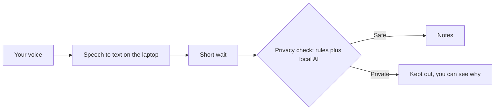

# How it works, in plain language

No technical knowledge needed.

## The idea

Most meeting notetakers write down everything. This one lets each person decide what goes into the notes,
and it also listens for what people say about privacy.

- Say "this is off the record" and what follows stays out of the notes.
- Say "strike that" and the last thing you said is removed.
- Mention something private, like a salary or a health problem, and it is kept out even if nobody asked.

The speech is turned into text on the host's own computer. It is not sent to an outside company to be written down.

## The flow

## The five steps

1. **You speak.** Your microphone sends your voice to the meeting. You choose whether the notes listen to you.
   If your notes are off, your voice is not turned into text at all.
2. **Words become text.** A speech tool on the host's computer writes down what you said. Each person is kept separate, so the notes know who said what.
3. **Wait a few seconds.** Each sentence waits briefly before it can reach the notes. This gives time to catch
   "strike that" and gives the checks time to run.
4. **Is it private?** Four checks run on the waiting sentence:
   - Contact details like phone numbers and emails are hidden.
   - Phrases like "off the record" and "back on the record" are noticed, and the system remembers whether you are currently off the record.
   - A small AI model on the same computer reads the sentence and decides whether it is about something private, like pay or health.
   - If a sentence looks private, it is kept out.
5. **The result.** Safe sentences go into the notes. Private ones stay out. You see which kinds of things were kept out, never what they said.

## What you see on screen

| Screen | What it shows |
|---|---|
| Realtime | The live meeting, the approved captions, and a small gray note where something was kept out |
| Insights | Two numbers (in your notes, kept private) and the kinds of things kept private |
| How it decides | A short explanation of each kind, and a three step trail when you tap a kept out item |

Tap a gray "kept out" note to see why. It never shows the private words.

## Where things run

| Part | Where |
|---|---|
| Your microphone and camera | In your browser |
| The call (audio and video) | A meeting server on the host's computer |
| Speech to text | The host's computer |
| The AI model that judges privacy | The host's computer, through a program called Ollama |
| The notes | The host's computer, in memory only |

Nothing is saved to disk by default: no recordings and no transcript files.

If the host shares the meeting through a web link, a tunnel service carries the page and the approved notes
between the host's computer and the guests. The tunnel company can see that traffic as it passes.
So "everything stays on the laptop" is true for the speech and the AI model, but not for the page itself.

## What it cannot do yet

- It is not perfect. On realistic test conversations it still lets a lot of private material through (roughly six in ten private items), and it sometimes removes harmless text. Treat it as a research prototype.
- It only listens to people who joined the meeting. If someone near a microphone speaks quietly in the background, the system tries to ignore it, but this is not guaranteed.
- If someone repeats what a private speaker said, that repeat can still reach the notes.
- It works best in English.
- Google Meet and Zoom are not supported yet.

## Words used in the docs

| Word | Meaning |
|---|---|
| Hold buffer | The short wait before a sentence can enter the notes |
| Cue | A phrase like "off the record" or "strike that" |
| Redact | Keep out of the notes |
| LiveKit | The program that runs the call |
| Whisper | The program that turns speech into text |
| Ollama | The program that runs the AI model on the host's computer |
| Presidio | The program that finds phone numbers, emails and similar details |
