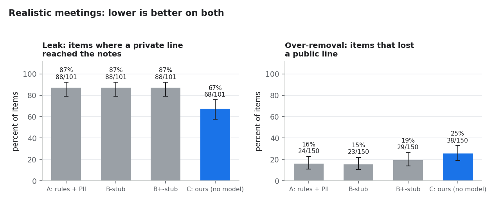
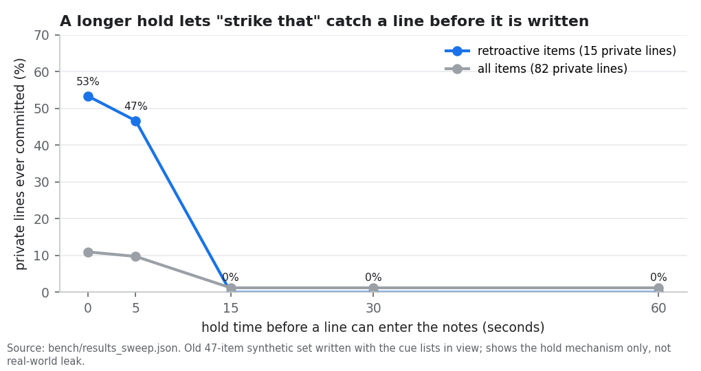
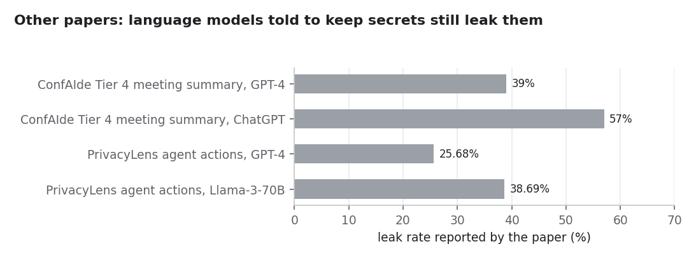

# Results

What the measurements in this repository show, and what they do not. Every chart is made by `python scripts/make_charts.py` from files in the repo; each chart names its source file. Nothing here was measured on real people in real meetings.

The short version: on realistic test data the pipeline keeps out more private content than simple rule baselines, but it still lets most private items through and it removes too much public text. It is a working design with a clear gap, not a solved problem.

## 1. Leak and over-removal on the sealed test set



OTR-Bench v2 uses real meeting turns from QMSum (AMI, ICSI and parliamentary committees) with private lines inserted. On the 150-item sealed split, our pipeline (C, no language model) let a private line into the notes in 68 of 101 items (67%). The three baselines leaked in 88 of 101 (87%), and the paired test against each of them is significant (exact McNemar, p < 0.001). The price is over-removal: C dropped at least one public line in 38 of 150 items (25%), against 15 to 19% for the baselines. On the 246-item dev split the picture is the same: C leaks 59%, the baselines 85 to 87%, and C over-removes 35%.

Caveat: the inserted private lines and their labels were written by language models and were not reviewed by people; B-stub and B+-stub are heuristic stand-ins, not real language models or products.

## 2. What the hold buys



Every line waits in a hold buffer before it can be written to the notes, so that a later "strike that" can still remove it. With no hold, 53% of the private lines in retroactive cases were written before the request arrived; with a 15 second hold or longer, none were. Across all items, the share of private lines ever written drops from 11% to 1%.

Caveat: this sweep ran on the old 47-item synthetic set, which was written with the cue lists in view; it shows that the mechanism works as designed, not how often it works in real speech. The 1% final leak on that set came from tuning on the same items and is not a result.

## 3. Context: published leak rates for language models



These are other papers' numbers, shown for context only. In ConfAIde, GPT-4 and ChatGPT put a secret into a meeting summary 39% and 57% of the time even though the prompt told them to keep it private. In PrivacyLens, agent actions leaked 25.68% (GPT-4) and 38.69% (Llama-3-70B) with a privacy-enhancing prompt. A single prompt is not a reliable privacy control, which is why this project puts consent and a gate in front of the notes.

Caveat: these benchmarks, models and metrics differ from OTR-Bench, so the bars cannot be compared with our leak rates; newer models with better prompting do much better (see [RESEARCH.md](RESEARCH.md), bottom line item 2).

## 4. What other notetakers document


The grid summarises what each product's own pages say, as recorded in [COMPETITORS.md](COMPETITORS.md). None of the pages read describes a person turning off capture of only their own voice, a privacy gate before the notes, a reaction to a spoken "off the record", or a record of what was withheld and why. Fireflies comes closest with a spoken pause command and a pause marker. Meetily matches us on local processing.

Caveat: "not found" means not described on the pages read, which is not proof that a product lacks it, and nothing was tested; for OTR, "yes" means the feature is built, and sections 1 to 3 show how well it works.

## 5. Other records

| Check | Result | Source |
|---|---|---|
| 36-item held-out set (synthetic, written by the team) | C leaked in 5 of 22 items (23%), baselines 77 to 82%; with simulated speech-recognition noise C leaked 32% | `bench/results_heldout.md`, `bench/results_heldout_noisy.md` |
| Local model on 40 sealed items | C with `granite4.2:3b` leaked 19 of 28 (68%); without the model 15 of 28 (54%); no evidence the model helps | `bench/results_v2_sealed_sample40*.md` |
| Redaction check, rules only (`python scripts/redaction_check.py`, 2026-10-22) | 9 of 10 scripted cases pass | script output |
| Redaction check with the local model (`--llm ollama`, `granite4.2:3b`) | 9 of 10 pass; the model labels salary and health instead of the keyword rules | script output |

The case that fails in both runs is "strike that" when a later public line follows: "The beta ships on the fourteenth" is removed along with the private line. The redaction check cases were written to demo the behaviour and are not a benchmark.

## How to rebuild

```
python scripts/make_charts.py
```

It reads only the files named on each chart, checks that the published numbers and every grid cell still match RESEARCH.md and COMPETITORS.md, and writes the same PNGs on every run.
